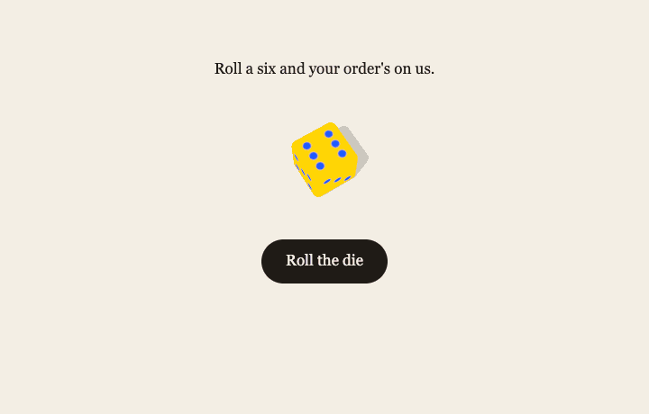

# @andrewrip/matka

Roll a six and your order's free. After paying through Stripe Checkout, the customer rolls a
die on your thanks page. On a six, the whole order is refunded, and the order still ships.

It's a web version of the Matka dice game at Dishoom, for Svelte and SvelteKit.



- **The server decides.** The roll is made with `crypto.randomInt` when Stripe says the order is
  paid, and kept against the Checkout session: one paid order, one roll. The browser only
  reveals it.
- **It can't be gamed.** Revealing again, replaying requests or editing the page's JavaScript
  never changes the face and never refunds twice. A refund only ever goes back to the card that
  paid.
- **The refund comes on reveal, not on payment**, so Stripe's refund email doesn't spoil the
  moment.
- **It uses your webhook.** You call `matka.handleEvent(event)` from the Stripe webhook you
  already have.
- **It's accessible.** A real button, the result announced to screen readers, and
  `prefers-reduced-motion` respected, whatever the theme.

## Contents

- [What you need](#what-you-need)
- [Install](#install)
- [Set up](#set-up)
- [Try it in test mode](#try-it-in-test-mode)
- [Before going live](#before-going-live)
- [Where rolls are kept](#where-rolls-are-kept)
- [API](#api)
- [How it stays fair](#how-it-stays-fair)
- [Troubleshooting](#troubleshooting)

## What you need

- **Stripe Checkout** for one-off payments (`mode: 'payment'`).
- **Svelte 5** for the `<Matka>` component. The server half doesn't need SvelteKit: it runs
  anywhere with web-standard `Request` and `Response` on Node 20 or later (SvelteKit, Netlify
  Functions and so on).
- **Somewhere to keep rolls:** Netlify Blobs, Supabase (or any Postgres behind PostgREST), or
  [your own store](#your-own-store).

## Install

```sh
npm i @andrewrip/matka
```

Then whichever of these you use:

```sh
npm i @netlify/blobs            # to keep rolls in Netlify Blobs
npm i @supabase/supabase-js     # to keep rolls in Supabase
npm i three cannon-es           # for the 3D dice
```

| Import                             | What's in it                                               |
| ---------------------------------- | ---------------------------------------------------------- |
| `@andrewrip/matka`                 | `<Matka>`, `<FlatDie>`, types. Browser-safe.               |
| `@andrewrip/matka/server`          | `createMatka`. Server only: it throws in a browser bundle. |
| `@andrewrip/matka/server/blobs`    | `blobsStore()` for Netlify Blobs                           |
| `@andrewrip/matka/server/supabase` | `supabaseStore()` for Supabase                             |
| `@andrewrip/matka/server/memory`   | `memoryStore()`, for tests                                 |
| `@andrewrip/matka/themes/dice3d`   | `<Dice3D>`, `<PrimaryDice>`: 3D dice, loaded lazily        |

## Set up

These steps use SvelteKit and Netlify Blobs. Other frameworks and stores work the same way.

### 1. Mark your Checkout sessions

When you create the Checkout session, add something that marks it as this site's, and send the
customer back with the session ID:

```ts
const session = await stripe.checkout.sessions.create({
	mode: 'payment',
	line_items,
	metadata: { shop: 'my-shop' },
	success_url: `${origin}/thanks?session_id={CHECKOUT_SESSION_ID}`,
	cancel_url: origin
});
```

You may already have something that marks your sessions, such as an order ID in `metadata`. If
so, use that.

### 2. Create one Matka, on the server

```ts
// src/lib/server/matka.ts
import Stripe from 'stripe';
import { getStore } from '@netlify/blobs';
import { createMatka } from '@andrewrip/matka/server';
import { blobsStore } from '@andrewrip/matka/server/blobs';

export const stripe = new Stripe(process.env.STRIPE_SECRET_KEY!);

export const matka = createMatka({
	stripe,
	store: blobsStore(getStore({ name: 'matka', consistency: 'strong' })),
	// Which Checkout sessions are this site's.
	accepts: (session) => session.metadata?.shop === 'my-shop'
});
```

`accepts` is required. One Stripe account can sell for several sites, and every site's webhook
hears about every session. A site that rolled for another site's sessions would give those
customers a second roll.

### 3. Pass your webhook's events to it

After verifying the signature, pass every event to `handleEvent`. It ignores the ones it doesn't
need.

```ts
// src/routes/api/stripe-webhook/+server.ts
import { matka, stripe } from '$lib/server/matka';

export async function POST({ request }) {
	let event;
	try {
		event = stripe.webhooks.constructEvent(
			await request.text(),
			request.headers.get('stripe-signature') ?? '',
			process.env.STRIPE_WEBHOOK_SECRET!
		);
	} catch {
		return new Response(null, { status: 400 });
	}

	// ...whatever else your webhook does

	try {
		await matka.handleEvent(event);
	} catch {
		return new Response(null, { status: 500 }); // Stripe tries again later
	}
	return new Response(null, { status: 200 });
}
```

In Stripe, subscribe the webhook to these three events:

- `checkout.session.completed`
- `checkout.session.async_payment_succeeded`
- `checkout.session.async_payment_failed`

### 4. Serve the endpoint

The component talks to this endpoint.

```ts
// src/routes/api/matka/+server.ts
import { matka } from '$lib/server/matka';

export const GET = ({ request }) => matka.handler(request);
export const POST = ({ request }) => matka.handler(request);
```

On Netlify Functions, it's one line:

```ts
// netlify/functions/matka.ts
import { matka } from './_matka';

export default matka.handler;
export const config = { path: '/api/matka' };
```

### 5. Show it on the thanks page

```svelte
<!-- src/routes/thanks/+page.svelte -->
<script>
	import { page } from '$app/state';
	import { Matka } from '@andrewrip/matka';
	import { Dice3D } from '@andrewrip/matka/themes/dice3d';
</script>

<Matka sessionId={page.url.searchParams.get('session_id')} theme={Dice3D} />
```

Without `theme`, you get a flat SVG die with no extra dependencies. The component only fetches
in the browser, so it works on a prerendered or static (adapter-static) thanks page.

### 6. Sweep up once a day

A six is refunded when it's revealed. A customer who closes the tab before the thanks page loads
would never reveal theirs, and a refund that fails (Stripe is down, say) is only tried again on
the next reveal. So once a day, call `sweep()`: it reveals the rolls nobody has revealed for a
day, refunding the sixes, and tries again any refund that failed. Stripe emails the customer
about the refund, if refund emails are on in your Stripe settings.

On Netlify, as a scheduled function:

```ts
// netlify/functions/matka-sweep.ts
import { matka } from './_matka';

export default async () => {
	const { revealed, refunded, pending } = await matka.sweep({
		before: new Date(Date.now() - 24 * 60 * 60 * 1000)
	});
	console.log(`[matka] revealed ${revealed}, refunded ${refunded}`);
	if (pending.length) console.error('[matka] refunds still failing:', pending);
};

export const config = { schedule: '@daily' };
```

Anywhere else, run the same from a cron job. `pending` lists the wins whose refund still
failed: worth an alert, and a look in Stripe.

## Try it in test mode

1. Use your Stripe test keys, and forward webhooks to your dev server:

   ```sh
   stripe listen --forward-to localhost:5173/api/stripe-webhook \
     --events checkout.session.completed,checkout.session.async_payment_succeeded,checkout.session.async_payment_failed
   ```

2. Pay with the card `4242 4242 4242 4242`. You land on the thanks page with a die to roll.
3. To see a win without paying six times, make every roll a six, in development only, with
   this option in `createMatka`:

   ```ts
   rng: dev ? () => 6 : undefined,
   ```

## Before going live

- [ ] Subscribe your live webhook to the three events above.
- [ ] If you use a restricted API key, give it **Refunds: Write**. Matka only creates and lists
      refunds.
- [ ] Run `sweep()` once a day ([step 6](#6-sweep-up-once-a-day)).
- [ ] Use a store that's shared between server instances: not `memoryStore`. With Netlify Blobs,
      use `consistency: 'strong'`.
- [ ] Budget for it. On average one order in six is refunded in full, shipping included, and
      Stripe keeps its processing fee on refunded payments.
- [ ] Check the law where you sell. In the UK, a draw included with a purchase at the normal price
      is generally treated as a promotion rather than a lottery. This isn't legal advice.

## Where rolls are kept

### Netlify Blobs

```ts
import { getStore } from '@netlify/blobs';
import { blobsStore } from '@andrewrip/matka/server/blobs';

const store = blobsStore(getStore({ name: 'matka', consistency: 'strong' }));
```

`consistency: 'strong'` is required: the store uses conditional writes, and they need it.

### Supabase

Run [`sql/001_matka_rolls.sql`](sql/001_matka_rolls.sql), then
[`sql/002_matka_won.sql`](sql/002_matka_won.sql), in your database (they're also in the package,
in `node_modules/@andrewrip/matka/sql/`). Coming from 0.1.0, run just the second. Then:

```ts
import { createClient } from '@supabase/supabase-js';
import { supabaseStore } from '@andrewrip/matka/server/supabase';

const store = supabaseStore(createClient(SUPABASE_URL, SUPABASE_SERVICE_ROLE_KEY));
```

Use the service role key, on the server only. The tables have row level security on with no
policies, so no other key can read or write them. To use other table names, pass
`supabaseStore(client, { table, noneTable })`.

### Your own store

To keep rolls anywhere else, implement `MatkaStore`:

```ts
interface MatkaStore {
	create(roll: Roll): Promise<Roll>; // only if there's none for the session; returns the stored one
	get(sessionId: string): Promise<Roll | null>;
	// sets revealedAt if unset; first is true only for the call that set it; null if no roll
	markRevealed(sessionId: string, at: string): Promise<{ roll: Roll; first: boolean } | null>;
	// sets refundTriedAt = at if revealed, not refunded, and last tried before staleBefore
	claimRefund(sessionId: string, at: string, staleBefore: string): Promise<boolean>;
	recordRefund(sessionId: string, refundId: string): Promise<Roll>; // only if unset
	listUnrevealed(options?: { before?: string }): Promise<Roll[]>; // oldest first
	listUnrefunded(): Promise<Roll[]>; // revealed wins with no refundId, oldest first
	markNone(sessionId: string, at: string): Promise<void>; // this session will never have a roll
	isNone(sessionId: string): Promise<boolean>;
}
```

Times are ISO 8601 strings. Each write must be atomic, because those writes are what stop a
duplicate webhook rolling twice and a double click refunding twice. The
[shared store tests](https://github.com/a-rbsn/matka/blob/main/src/lib/server/stores.test.ts)
run against every built-in store. Copy them to test yours.

## API

### `createMatka(options)`

From `@andrewrip/matka/server`.

| Option        | Default            |                                                                                                                |
| ------------- | ------------------ | -------------------------------------------------------------------------------------------------------------- |
| `stripe`      | (required)         | Your Stripe client. Only `refunds.create` and `refunds.list` are used.                                         |
| `store`       | (required)         | Where rolls are kept: a `MatkaStore`.                                                                          |
| `accepts`     | (required)         | `(session) => boolean`, or a promise of one: whether a Checkout session is this site's.                        |
| `sides`       | `6`                | Faces on the die.                                                                                              |
| `winningFace` | `6`                | The face that refunds the order. It's stored with each roll, so changing it later doesn't change old outcomes. |
| `rng`         | `crypto.randomInt` | `(sides) => number`, from 1 to `sides`. For tests and development only.                                        |

It returns an object with these methods:

**`handleEvent(event)`** → `Promise<Roll | null>`. Call it from your webhook with a verified
event. A paid session gets a roll, and a duplicate event returns the roll that already exists.
A session that will never have a roll (a £0 order, a subscription, a bank payment that failed)
is marked, so the endpoint can say so. Other events, and sessions `accepts` turns down, are
ignored. If it throws, answer 500 so Stripe tries again.

**`handler(request)`** → `Promise<Response>`. The endpoint, as a web-standard handler, taking
`?session_id=cs_…`:

- `GET` calls `status()`: it looks without revealing.
- `POST` calls `reveal()`: it reveals, and refunds a win.
- A malformed session ID gets a 400, other methods a 405, and a failure a 500 with no details.
  Responses are never cached.

**`reveal(sessionId)`** → `Promise<MatkaReveal>`. Reveals the roll, and refunds it on a win.
Every call returns the same face, and only one refund is ever made. It returns one of:

- `{ status: 'rolled', face, sides, winningFace, win, firstReveal, refund }`. `firstReveal` is
  true only for the call that revealed it. `refund` is `'none'` (a loss), `'issued'`, or
  `'pending'` (the refund failed, and a later reveal tries again).
- `{ status: 'pending' }`: no roll yet. The webhook may be on its way, or a bank payment is
  still going through.
- `{ status: 'none' }`: the webhook said no roll is coming.

**`status(sessionId)`** → `Promise<MatkaStatus>`. The same without revealing: `pending`, `none`,
`{ status: 'ready', sides, winningFace }` (rolled, but the face isn't sent until it's revealed),
or `rolled`.

**`listUnrevealed({ before?: Date })`** → `Promise<Roll[]>`. Rolls nobody has revealed, oldest
first: for a reminder email, say.

**`listUnrefunded()`** → `Promise<Roll[]>`. Revealed wins whose refund hasn't gone through, oldest
first. `reveal()` tries each one again.

**`sweep({ before: Date })`** → `Promise<{ revealed, refunded, pending }>`. For a daily job
([step 6](#6-sweep-up-once-a-day)). It reveals the rolls nobody revealed before `before`
(refunding the sixes), then tries again the refunds that failed. `revealed` and `refunded` are
counts. `pending` lists the session IDs of wins whose refund still failed. A refund tried in the
last 30 seconds isn't tried again yet, so it's listed as pending too.

A `Roll` is:

```ts
interface Roll {
	sessionId: string; // the Checkout session, cs_…
	paymentIntent: string; // what a win refunds
	face: number;
	sides: number;
	winningFace: number;
	createdAt: string; // ISO 8601
	revealedAt: string | null;
	refundTriedAt: string | null;
	refundId: string | null; // re_…, or ALREADY_REFUNDED if it was refunded by hand before the reveal
}
```

The server entry also exports `isSessionId(id)`, `MatkaError` and `ALREADY_REFUNDED`.

### `<Matka>`

From `@andrewrip/matka`.

| Prop         | Default      |                                                                                                      |
| ------------ | ------------ | ---------------------------------------------------------------------------------------------------- |
| `sessionId`  | (required)   | The Checkout session ID. If it's `null` or empty, the component shows nothing.                       |
| `endpoint`   | `/api/matka` | Where `matka.handler` is served.                                                                     |
| `theme`      | `FlatDie`    | A component that draws the die (see [Themes](#themes)).                                              |
| `themeProps` |              | More props for the theme, such as `Dice3D`'s colours.                                                |
| `copy`       | English      | Any of the words to change (see below).                                                              |
| `pause`      | `true`       | A beat (0.7 s) of stillness after the die lands, before the verdict.                                 |
| `showLoss`   | `true`       | Show the words for a loss. When off, they're only read to screen readers. A win's words always show. |
| `onresult`   |              | `(result) => void`, called with the `rolled` result once it's shown.                                 |

What it does:

- **It handles everything except drawing the die:** state, fetching and words. While the webhook
  is on its way, it checks every 2 seconds for about 30 seconds, then shows a "check again"
  button. A revisit shows the result at rest, with no button. For a session with no roll coming
  (a £0 order), it shows nothing.
- **Accessibility.** It uses a real button. An `aria-live` status announces the result, and gets
  focus after a roll. With `prefers-reduced-motion`, it skips straight to the result, whatever
  the theme.
- **Styling.** Its styles have zero specificity (`:where()`), so yours always win. Set
  `--matka-size` for the size of the die's box. The classes are `.matka`, `.matka-stage`,
  `.matka-intro`, `.matka-button` and `.matka-message`. `.matka` has a `data-step` attribute for
  styling each state: `loading`, `pending`, `late`, `ready`, `revealing`, `rolling`, `settling`,
  `landed` or `error`.

#### Words

Pass any of these as `copy` to change them. The rest stay in English.

| Key          | Type                                       | Default                                                        |
| ------------ | ------------------------------------------ | -------------------------------------------------------------- |
| `intro`      | `({ sides, winningFace }) => string`       | "Roll a six and your order's on us."                           |
| `button`     | `string`                                   | "Roll the die"                                                 |
| `rolling`    | `string`                                   | "Rolling…"                                                     |
| `pending`    | `string`                                   | "Getting your die ready…"                                      |
| `late`       | `string`                                   | "Your die isn't ready yet. It can take a minute after paying." |
| `checkAgain` | `string`                                   | "Check again"                                                  |
| `error`      | `string`                                   | "Something went wrong. Your roll is safe: …"                   |
| `tryAgain`   | `string`                                   | "Try again"                                                    |
| `win`        | `({ face, sides, winningFace }) => string` | "You rolled a six! Your order's on us: …"                      |
| `lose`       | `({ face, sides, winningFace }) => string` | "You rolled a four. Not this time, …"                          |

```svelte
<Matka {sessionId} copy={{ button: 'Throw it', win: () => 'A six! This one is on us.' }} />
```

`defaultCopy` and `aFace(n)` ("a six", "an eight") are exported too.

### Themes

A theme draws the die and nothing else. It's a Svelte component that gets these props:

```ts
interface ThemeProps {
	phase: 'waiting' | 'rolling' | 'landed';
	face: number | null; // set from the moment it starts rolling
	sides: number;
	onlanded: () => void; // call once, when the roll comes to rest
	win: boolean | null; // null until the verdict's shown, then whether it won
}
```

- In `waiting`, show the die before it's thrown.
- In `rolling`, animate for as long as you like, end on `face`, then call `onlanded`. If it's
  never called, `<Matka>` moves on after 10 seconds.
- In `landed`, show `face` at rest, without animating. This phase is also used for revisits and
  reduced motion.
- Once `win` is set, you can celebrate a win (respecting `prefers-reduced-motion`).

Here's a complete theme that shows the face as a number:

```svelte
<!-- NumberDie.svelte -->
<script lang="ts">
	import type { ThemeProps } from '@andrewrip/matka';

	let { phase, face, sides, onlanded, win }: ThemeProps = $props();

	let shown = $state(1);

	$effect(() => {
		if (phase === 'waiting') shown = sides;
		if (phase === 'landed' && face) shown = face;
		if (phase !== 'rolling' || !face) return;
		const target = face;
		const spin = setInterval(() => (shown = 1 + Math.floor(Math.random() * sides)), 80);
		const stop = setTimeout(() => {
			clearInterval(spin);
			shown = target;
			onlanded();
		}, 1000);
		return () => {
			clearInterval(spin);
			clearTimeout(stop);
		};
	});
</script>

<div class="die" class:win role="presentation">{shown}</div>

<style>
	.die {
		display: grid;
		place-items: center;
		height: 100%;
		border: 4px solid;
		border-radius: 16%;
		font: 600 3rem/1 system-ui;
	}
	.win {
		color: gold;
	}
</style>
```

### `<Dice3D>`

From `@andrewrip/matka/themes/dice3d`. Install `three` and `cannon-es` to use it.

A die is thrown in from beyond the edge of the window. It flies across the page, over
everything (clicks pass through), bounces, tumbles, and settles in its place. The throw is real
physics, simulated in advance, and the side that ends on top is then given the server's number.
Opposite faces still add up to 7, as on a real die.

three and cannon-es load when the theme mounts (about 160 KB gzipped). Without WebGL, or for a
die that isn't six-sided, it falls back to `FlatDie`.

Pass its props with `themeProps`:

```svelte
<Matka {sessionId} theme={Dice3D} themeProps={{ color: '#111', pipColor: '#fff', dance: 'walk' }} />
```

| Prop       | Default    |                                                                                                                                     |
| ---------- | ---------- | ----------------------------------------------------------------------------------------------------------------------------------- |
| `color`    |            | The die's colour. Changing it repaints the die in place.                                                                            |
| `pipColor` |            | The pips' colour.                                                                                                                   |
| `finish`   | `'glossy'` | `'glossy'`: soft light and reflections. `'flat'`: unlit, every side one bright colour, with a hard shadow.                          |
| `slowmo`   | `true`     | Slow motion (40%) around the die's last topple: the "will it go over?" moment.                                                      |
| `dance`    | `'hop'`    | What a win does once the verdict's shown, until the page is left: `'hop'`, `'walk'` or `false`. It stays still with reduced motion. |
| `landing`  | `'stage'`  | Experimental. `'anywhere'` lets the die come to rest anywhere in the middle of the window.                                          |

### `<PrimaryDice>`

`Dice3D` with the flat finish in two primary colours, picked fresh for each throw: one for the
die, one for its pips. Only pairs with at least 3:1 contrast (WCAG's bar for graphics) are
picked, so the pips can always be read: yellow (`#ffd500`) with red (`#f2140e`) or blue
(`#1e5bff`), either way round. Pass `palette` (two or more hex colours) to choose from others.
Pairs under 3:1 are skipped, and if none reach it, the pair with the most contrast is used.

## How it stays fair

1. **One roll per order.** The store creates a roll only if none exists for the session
   (Postgres's primary key, Blobs' `onlyIfNew`).
2. **One reveal.** Setting `revealedAt` is a conditional write, and only the call that sets it
   refunds.
3. **One refund.** The refund uses Stripe's idempotency key `matka-refund:<session>` and
   `metadata.matka = <session>`. Before refunding, Matka looks for a refund it made but didn't
   record. Refunds are always for the whole charge, and Stripe never refunds more than was paid. An
   order already refunded by hand counts as refunded.
4. **Failed refunds are tried again.** If a refund fails (Stripe is down, the process crashes,
   the charge is disputed), the result still comes back with `refund: 'pending'`, and a later
   reveal, or the daily `sweep()`, tries again. Each try holds a 30-second lease, so tries can't overlap, and a refund
   that keeps failing is tried at most twice a minute, however often it's revealed.
5. **Rolls can't be edited.** In Postgres, a trigger refuses any change to a roll except setting
   `revealed_at` and `refund_id` once each, and the retry lease.
6. **The endpoint never calls Stripe on a stranger's say-so.** Before the webhook has arrived, it
   only reads your store. Made-up session IDs can't use up your Stripe API rate limit.

Anyone with the thanks page's URL can reveal the roll. That's harmless: the face was decided at
payment, and a refund only ever goes back to the card that paid.

To report a security problem, see [SECURITY.md](SECURITY.md).

## Troubleshooting

**The die says it isn't ready yet.** The roll is made when your webhook calls `handleEvent`.
Check that the webhook gets `checkout.session.completed`, verifies it, and reaches
`handleEvent`, and that `accepts` returns `true` for the session. With bank payments (Bacs,
SEPA), the roll comes when the payment clears, which can take days.

**Nothing shows at all.** For a £0 order, a subscription or a failed bank payment, `<Matka>`
shows nothing on purpose. It also shows nothing if `sessionId` is missing: check that your
success URL has `?session_id={CHECKOUT_SESSION_ID}`.

**"@andrewrip/matka/server was imported in browser code".** `createMatka` and the stores hold
your Stripe key, so they're server-only. Import them only from server files (`+server.ts`,
`+page.server.ts`, `hooks.server.ts`, `$lib/server/`, or a serverless function).

## Contributing

Issues and pull requests are welcome. [CONTRIBUTING.md](CONTRIBUTING.md) covers running the demo
and the tests.

## License

[MIT](LICENSE)
